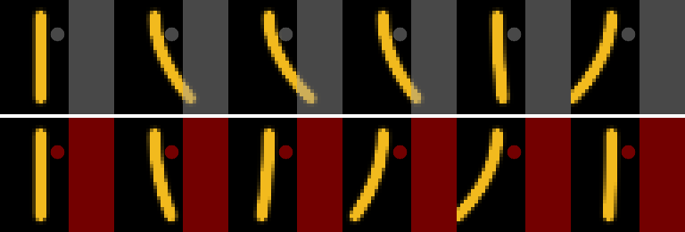

# LaGSplat Contact

**Make a video-learned object collide with obstacles.** Place a wall, a disc
or a box anywhere in the image, and the simulated object stops against it and
swings back, instead of passing through.

LaGSplat Contact extends
[LaGSplat](https://github.com/LouenPottier/LaGSplat) (Louen Pottier,
[arXiv:2608.16324](https://arxiv.org/abs/2608.16324)). LaGSplat learns, from
monocular video, how an object moves: a Lagrangian dynamics in a small latent
state `q`, rendered by Gaussian Splatting. The decoder's Gaussians are explicit
points `mu_k(q)` that move with the object, and this fork uses them as contact
points:

- a Gaussian that enters an obstacle is pushed back by a penalty force `f_k`;
- the forces on all the Gaussians are mapped back to the latent as
  `Q = sum_k J_k^T f_k`, which enters the equations of motion;
- the object's reaction then comes from the dynamics learned from the video.
  No contact has to be filmed or labelled for training.

Status: validated on a synthetic scene (below). The contact parameters have not
yet been tuned on a trained checkpoint of the real robot (see [Limits](#limits)).



*Test scene drawn with the pure-torch rasterizer: a bar of 60 Gaussians that
bends with the latent, under a damped-spring dynamics. Top row: without
collisions, the bar goes through the wall (grey). Bottom row: with collisions,
it stops at the wall (red) and swings back. The disc is never reached and has no
effect.*

## Quick start

Collisions run at inference time on a trained LaGSplat model. The first
commands train that model, on the two-segment soft continuum robot of Krauss et
al. 2026 (see [Base model](#base-model)):

```bash
py -m pip install -r requirements.txt        # read the file: torch and gsplat first
py scripts/fetch_data.py --seg 2seg          # Zenodo, SHA256 check, 80/20 split
py scripts/run_2seg_npz.py                   # trains the base model (several GPU hours)
```

Then roll it out against obstacles:

```bash
cd code
py sim_collision.py --config ../cases/krauss2026_2seg_npz/config.py \
    --lnn lnn_lr1e-3_c1_s1_500ep_seed0.pt --video scr_2seg_32x32_val20.npz \
    --sigma 1 --sigma-pressure 1 --cq-eps 1 \
    --obstacle "disc:0.70,0.60,0.12"      # repeatable
```

## How it works

1. **Contact points.** The centre of Gaussian `k` in the decoder's conditional
   slice is affine in the latent:
   `mu_k(q) = mu_xy,k + J_k (q - mu_z,k)`, with `J_k = Sigma_xz,k Sigma_zz,k^-1`.
   Its Jacobian `J_k` is therefore exact and constant, so contact needs no
   autograd through the decoder. Because the LNN runs in the whitened latent `u`,
   it uses `J_k W_inv^T` instead.
2. **Obstacles.** Each obstacle is a fixed rigid solid, given by its signed
   distance `phi(x)` in normalised image coordinates (`[0, 1]^2`, `x` to the
   right, `y` down). Available shapes are a half-plane, a disc and an
   axis-aligned box.
3. **Contact force.** Gaussian `k` has a radius `r_k`: its largest conditional
   standard deviation, times `COLLISION_RADIUS_SCALE`. It penetrates by
   `delta_k = max(0, r_k - phi(mu_k))` and receives a Kelvin-Voigt penalty along
   the normal `n = grad phi`:
   `f_n = max(0, k_c delta_k - c_c n . xdot_k)`, where `xdot_k = J_k qdot`. The
   force never pulls the object towards the obstacle. Regularised Coulomb
   friction can be added.
4. **Presence weighting.** Each force is weighted by
   `alpha_k w_z,k(q) / sum_j alpha_j w_z,j(q)`, the Gaussian's share of what is
   visible at the current state. A Gaussian that is switched off at that state
   touches nothing, and the stiffness does not depend on how many Gaussians the
   decoder has.
5. **Pull-back into the dynamics.** The latent generalised force
   `Q = sum_k J_k^T f_k` is added to the right-hand side of the Euler-Lagrange
   equations, before the mass solve. Background Gaussians do not move, so they
   have `J_k ~ 0` and transmit nothing: only the moving part of the object is
   pushed back.

## Usage

The script writes `collision.mp4` (left: free, right: with contact) and a
`.npz` holding the latent trajectories and penetrations to the case's
`checkpoints/`. It also prints the largest penetration in pixels, with and
without contact. Without `--obstacle`, it places a wall half-way along the
object's largest movement, so that contact happens. Other options:
`--start-sec`, `--horizon-sec` (3 s by default), `--no-pressure` for free
oscillation, and `--stiffness`, `--damping`, `--friction`, `--radius-scale` and
`--substeps`.

Obstacle syntax, in image coordinates from 0 to 1:

| Spec | Obstacle |
|---|---|
| `plane:px,py,nx,ny` | solid half-plane through `(px, py)`; `n` points towards free space |
| `disc:cx,cy,r` | solid disc |
| `box:x0,y0,x1,y1` | solid axis-aligned rectangle |

From code:

```python
from collisions import build_contact
contact = build_contact(decoder, whiten, ["plane:0.6,0,-1,0"])
traj = simulate_rk4(lnn, z0, v0, n_steps, dt, pressure=p, collision=contact)
```

## Settings (`code/config.py`)

| Key | Default | Meaning |
|---|---:|---|
| `COLLISION_OBSTACLES` | `[]` | obstacle specs; empty means no contact |
| `COLLISION_STIFFNESS` | `2e3` | penalty stiffness `k_c`, per unit of total presence |
| `COLLISION_DAMPING` | `20` | normal damping `c_c` |
| `COLLISION_FRICTION` | `0` | Coulomb coefficient (0 means frictionless sliding) |
| `COLLISION_RADIUS_SCALE` | `1` | `r_k` in conditional standard deviations; 0 treats centres as points |
| `COLLISION_MIN_PRESENCE` | `1e-3` | Gaussians with an opacity below this are ignored |
| `COLLISION_SUBSTEPS` | `4` | integration steps per frame in `sim_collision.py` |

## What this fork changes

| File | Change |
|---|---|
| `code/collisions.py` | new: the `HalfPlane`, `Disc` and `Box` obstacles, `parse_obstacle`, the `GaussianContact` force `Q(q, qdot)`, and `build_contact`, which reads its settings from the config |
| `code/viz.py` | `simulate_rk4(..., collision=None)` adds `Q`, for all three integrators (`verlet`, `rk4`, `gen_alpha`) |
| `code/models.py` | `LNN.accel(..., f_ext=None)`, so that the learned or curved mass path also receives the force |
| `code/config.py` | new `COLLISION_*` settings, off by default |
| `code/sim_collision.py` | new script: runs the free rollout and the rollout with contact from the same initial state and pressure, and writes them side by side to an MP4 with the obstacles drawn |

Collisions are off by default (`COLLISION_OBSTACLES = []`): with no
obstacle, the code computes exactly what upstream LaGSplat computes.

## Validation

These checks run without gsplat and without checkpoints, using the pure-torch
decoder:

- the contact centres and `J_k` match the decoder's own Schur-complement
  computation, with whitening, and `J_k` matches an autograd Jacobian;
- a point mass thrown at a wall bounces back with all three integrators, and
  penetrates about 1.5 % of the image instead of passing through;
- in the bending-bar scene above, the bar tip reaches `x = 0.737` without
  collisions and `x = 0.593` with them (wall at 0.6). The largest penetration
  drops from 5.2 px to 0.6 px, and the rendered mass behind the wall drops from
  8.1 to 0.01;
- with the real `LNN` class and the case config (learned mass, pressure
  forcing), rollouts stay finite with every integrator, and contact changes the
  trajectory.

## Limits

- The contact is an explicit penalty. It is stable while `omega_c dt < 2`. If
  contact tunnels or blows up, raise `--substeps` or lower `--stiffness`. The
  default stiffness has not been tuned on a trained checkpoint.
- No contact was seen in training. The response is what the learned Lagrangian
  predicts under an external force; it has not been checked against real
  contact footage.
- Contact is between the Gaussians and fixed obstacles only. Self-collision and
  moving obstacles are not modelled.

## Base model

The base model, its training protocol and its numbers are those of
upstream LaGSplat. They reproduce one result of the paper: multi-step
prediction on the two-segment soft continuum robot of Krauss et al. 2026,
on their data and their split. This fork does not change them.

### Results

Two segments, four chambers. MSE in pixels of `[0, 1]`, native 32 x 32 rendering.

| Model | d | AE floor (1e-5) | MSE 0.5 s (1e-3) | freq. error |
|---|---:|---:|---:|---:|
| Osc. + deconv | 10 | 5.43 | 22.7 | 76.8 % |
| Osc. + ABCD (VON) | 10 | 14.5 | 6.56 | 31.4 % |
| Koopman + deconv | 10 | 3.95 | 5.66 | 18.3 % |
| Koopman + ABCD | 10 | 5.17 | 0.984 | 8.3 % |
| **LaGSplat** | **4** | 6.31 | **0.696** | **3.9 %** |

Only the LaGSplat row is produced here. The baseline MSE values are the ones
published by the authors; their AE floors and frequency errors are our own
measurements on their released checkpoints. The frequency error compares a free
rollout to the video over the depressurised tail of the clip, with the same
spectral estimator on both: 1.5621 Hz observed against 1.5016 Hz held. Section 4
of the preprint defines the metrics.

### Operating point

| | value |
|---|---|
| Data | `scr_dataset_raw_2seg_32x32_59fps.npz` (Zenodo, `processed_data.zip`) |
| Images | 32 x 32 RGB, 59.94 fps (`DT = 1001/60000`) |
| Pressures | `p1..p4` from the NPZ, aligned by the authors, normalised by 101 325 Pa |
| Split | first 80 % train, last 20 % validation, contiguous (43 872 / 10 968 frames) |
| Latent | `d = 4`, frozen PCA whitening after the autoencoder |
| Decoder | 6D Gaussian Splatting (2 spatial + 4 latent dimensions) primitives rasterized with gsplat, 2048 Gaussians |
| LNN | learned mass `M(q)`, full dissipation `C(q)`, invex deformation potential, invex pressure forcing |
| LNN training | `lr 1e-3`, `c0 = 1`, `sigma 1`, 500 epochs, seed 0, frozen AE |

### Training protocol

The protocol is six steps: autoencoder, frozen PCA whitening of the latent,
visibility metric of the decoder, LNN, then the two evaluations. Steps 1 and 4
take several GPU hours. `fetch_data.py --zip <path>` avoids re-downloading the
4.5 GB Zenodo archive if it is already on the machine.

`gsplat` needs CUDA and a compilation step. Without it the code falls back on an
in-house pure-torch decoder, about 100 times slower and **not** weight
compatible with gsplat checkpoints. It is there to read and run the code, not to
reproduce the figures: set `DEC2PT_BACKEND = 'gsplat'` in the case config to
turn any silent fallback into an `ImportError`.

Individual steps: `py scripts/run_2seg_npz.py --dry-run` prints the commands,
and `--only 5` runs the MSE evaluation alone.

## Layout

```
code/            the LaGSplat implementation, and code/config.py, the base config
  collisions.py      obstacles and the contact force Q = sum_k J_k^T f_k
  sim_collision.py   free rollout vs. rollout with contact, as a video
cases/krauss2026_2seg_npz/
                 config.py of the case, overriding only what it changes;
                 data/ and checkpoints/ are produced locally
scripts/         fetch_data (Zenodo, checksum, split), run_2seg_npz (the protocol)
```

`code/` is the research implementation reduced to what this experiment needs.
A few optional code paths are still described in the comments but are not part
of it, and not part of the published protocol either: the curved decoder metric
(`LNN_METRIC_FROM_DECODER`), the MLP decoder, and the flow-based trimming of the
startup transient.

## Third-party data

The dataset comes from Zenodo, DOI `10.5281/zenodo.17812071`, archive
`processed_data.zip` (about 4.5 GB), under CC BY-ND 4.0, and `fetch_data.py`
checks its SHA256.

The reference implementation of Krauss et al. is at
[github.com/UThenrik/visual_oscillators_for_SCR](https://github.com/UThenrik/visual_oscillators_for_SCR)

## License

The code in this repository is released under the LaGSplat Research License
(`LICENSE`): free use, reproduction and modification for **non-commercial
academic research**, including verifying and reproducing the published results.
Commercial use, integration into a product or a service, and redistribution to
third parties require a separate written licence from the holder (CEA). No
patent licence is granted. Third-party data keeps its own terms, see above.

## Cite this work

LaGSplat Contact is built on LaGSplat. If you use it, cite the LaGSplat preprint:

```bibtex
@article{pottier2026lagsplat,
  title   = {LaGSplat: Inferring Physics-Governed Interactive Simulation from
             Monocular Video Using Latent Lagrangian Gaussian Splatting},
  author  = {Pottier, Louen},
  journal = {arXiv preprint arXiv:2608.16324},
  year    = {2026},
  url     = {https://arxiv.org/abs/2608.16324}
}
```

If you use the data, cite the dataset and the paper it comes with:

```bibtex
@dataset{krauss2026scrdataset,
  title     = {Soft Continuum Robot Dataset (SCR)},
  author    = {Krauss, Henrik and Licher, Johann and Takeishi, Naoya
               and Raatz, Annika and Yairi, Takehisa},
  year      = {2026},
  publisher = {Zenodo},
  doi       = {10.5281/zenodo.17812071},
  url       = {https://doi.org/10.5281/zenodo.17812071},
  note      = {CC BY-ND 4.0}
}

@ARTICLE{krauss2026von,
  author={Krauss, Henrik and Licher, Johann and Takeishi, Naoya and Raatz, Annika and Yairi, Takehisa},
  journal={IEEE Robotics and Automation Letters},
  title={Learning Visually Interpretable Oscillator Networks for Soft Continuum Robots From Video},
  year={2026},
  volume={11},
  number={8},
  pages={9495-9502},
  doi={10.1109/LRA.2026.3703241}}
